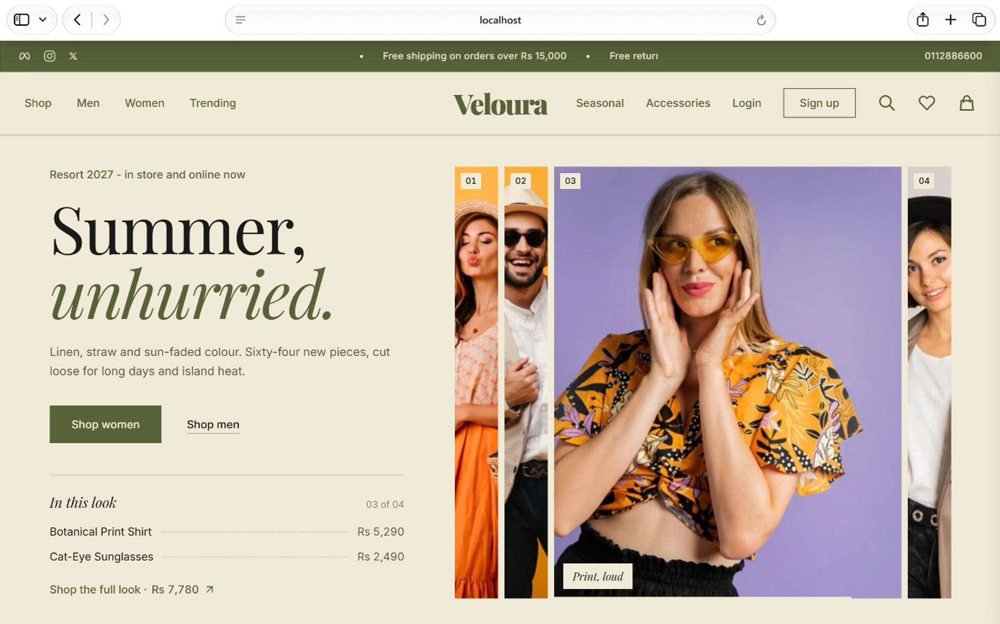
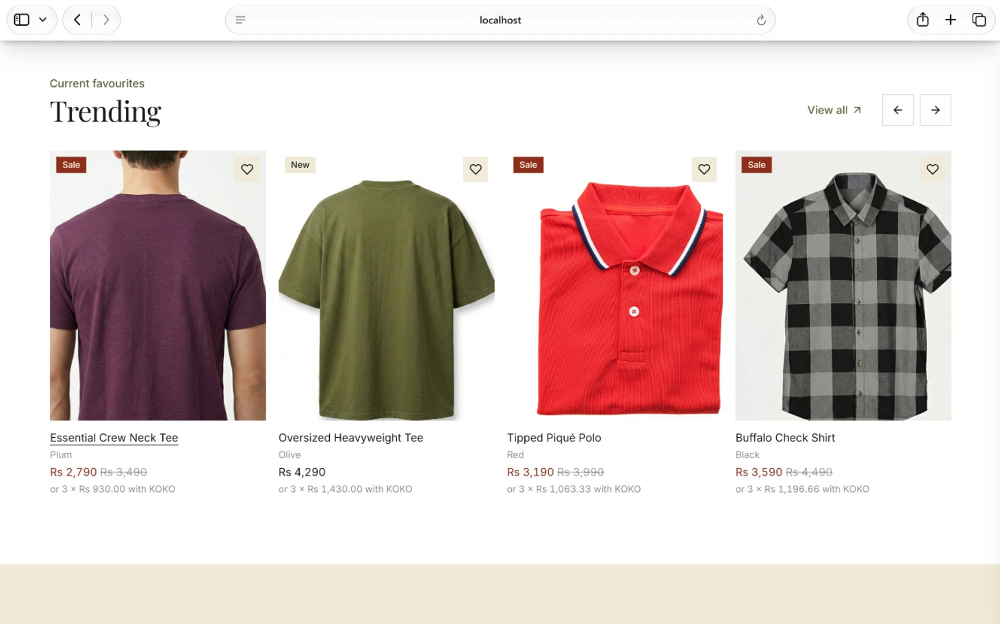
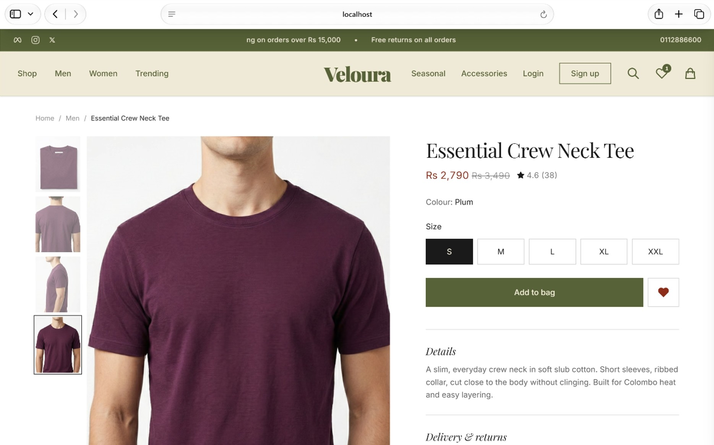

# Veloura

A B2C fashion e-commerce store for the Sri Lankan market, built with the MERN stack. Prices are in Rs (LKR), and the product pages include the instalment options local shoppers expect, like KOKO.

> **Project status: work in progress, not a working store yet.**
> The frontend is under active development and runs entirely on mock product data. The backend (Express + MongoDB) is still in the planning and early development stage. There are no real accounts, payments or orders. Login, sign up and checkout are UI only for now.

## 🌐 Live Preview

<a href="https://velourafashion.vercel.app/">
  
</a>


## 📸 Preview

<p align="center">
  
  
  
</p>


---

## Contents

- [What works right now](#what-works-right-now)
- [What's not built yet](#whats-not-built-yet)
- [Tech stack](#tech-stack)
- [Why Cloudinary](#why-cloudinary)
- [Project structure](#project-structure)
- [Running it locally](#running-it-locally)

---

## What works right now

Everything below runs in the browser on mock data. That data is shaped exactly like the backend's `Product` model, so moving to the real API later should be a swap of the data source, not a rewrite.

**Home page**
- A hero slider of four "shop the look" outfits. Each look lists its real products with prices and a full-look total. It autoplays, pauses on hover, and you can click through by hand.
- Product rails for Trending, New arrivals, Special offers and Accessories.
- A campaign banner slider with the text written in HTML instead of baked into the images. It has swipe support, autoplay with progress bars and pause on hover or focus.
- A Shop by category list with live piece counts worked out from the catalogue.

**Shopping**
- **Shop page:** filters for gender, category and size, plus sorting by newest or price. The filters live in the URL (`/shop?category=hats&sort=price-asc`), so any filtered view can be shared or bookmarked.
- **Dedicated pages:** Men, Women, Trending, Accessories and Seasonal (Resort 2027).
- **Product page:** image gallery, size picker with validation, stock limits, and sale and new badges.
- **Search:** a search panel from the navbar shows live results as you type. It matches every word, ignores accents ("pique" finds "Piqué") and handles plurals.
- **Bag:** a slide-out cart drawer with quantity controls, a running subtotal and a free-shipping progress message over Rs 15,000.
- **Wishlist:** save pieces with the heart icon and see them on `/wishlist`. A count badge shows in the navbar.
- **Saved between visits:** the bag and wishlist are kept in `localStorage`, so they survive a page refresh.

**General**
- Responsive from small phones up to wide desktops.
- A hide-on-scroll navbar that doesn't cause layout shift.
- Respects `prefers-reduced-motion`. Keyboard and screen reader friendly through dialog roles, `inert` on hidden panels, Escape to close, and labelled icon buttons.
- A custom 404 page.

## What's not built yet

- The backend API connection (the frontend still reads from `src/data/products.js`)
- User accounts and authentication
- Checkout, payments (card, KOKO, cash on delivery) and order history
- Admin panel for managing products and stock
- Pages linked from the footer, such as Customer care, Shipping and returns, Size guide, Privacy and Terms. These links point to the home page for now.
- Kids' products. The category exists, but there's no stock yet.

---

## Tech stack

**Frontend** (`frontend/app`)

| | |
|---|---|
| Framework | React 19 with Vite 7 |
| Routing | React Router 7 |
| Styling | Tailwind CSS v4, using `@theme` tokens and container queries |
| Icons | react-icons |
| State | React Context, persisted to `localStorage` |
| Images | Cloudinary, delivered through URL transformations |
| Linting | ESLint 9 |

**Backend** (`backend`), in early development

| | |
|---|---|
| Server | Node.js with Express 5 |
| Database | MongoDB Atlas with Mongoose 9 |
| Current endpoints | `GET /api/health`, `GET /api/products`, `GET /api/products/:id` |

**Design**
- Colours: moss `#576238`, eggshell `#F0EAD6`, fashion black `#1a1a1a`, terracotta `#8C2D19` (sale accents).
- Fonts: Playfair Display for headings and Inter for body text.

---

## Why Cloudinary

On a fashion store, the images are the product. They are also by far the heaviest thing on every page. A single category page can show dozens of photos, and most shoppers in Sri Lanka browse on phones over mobile data. If the images are slow, the store feels slow, and people leave before they buy.

Shipping the original photos with the app wasn't an option. So every image (products, editorial shots and banners) lives in Cloudinary, and the frontend asks for exactly the version it needs through the URL:

- **Right format, right quality.** `f_auto,q_auto` serves AVIF or WebP to browsers that support them, at a quality level picked per image. That is usually a fraction of the size of the original JPG.
- **Right size for the screen.** Every image has a `srcset` from 400 to 1600px wide, plus a `sizes` hint. A phone downloads a 400px image, not the 1600px desktop one.
- **Consistent crops without editing files.** Product photos are cropped to 4:5 with `c_fill,ar_4:5,g_auto`, so Cloudinary keeps the garment in frame even when the source photos have different shapes. Editorial images keep their own ratio with `c_limit`.
- **Cache busting.** When an image is replaced in Cloudinary under the same name, its version number goes into the URL, so browsers don't keep showing the old copy.
- **Lazy loading.** Images below the fold load lazily, and only the first hero image gets `fetchpriority="high"`.

---

## Project structure

```
.
├── backend/                 Express + MongoDB API (early stage)
│   ├── config/db.js         MongoDB Atlas connection
│   ├── controllers/         product controller
│   ├── middleware/          404 + error handler
│   ├── models/Product.js    product schema the frontend mirrors
│   ├── routes/              /api/products
│   └── index.js
└── frontend/app/            React + Vite storefront
    ├── scripts/             cloudinary-list.mjs
    └── src/
        ├── components/      layout, hero, collections, products, cart
        ├── context/         bag + wishlist store
        ├── data/            mock products and looks
        ├── lib/             cloudinary, search, price formatting
        └── pages/           Home, Shop, Product, Seasonal, Wishlist, ...
```

---

## Running it locally

You need Node.js 20.19 or newer (Vite 7 requires it).

**Frontend**

```bash
cd frontend/app
npm install
npm run dev          # http://localhost:5173
```

Other scripts: `npm run build`, `npm run preview` and `npm run lint`.

The frontend doesn't need the backend or any keys to run. Product images load from the public Cloudinary URLs.

**Backend** (optional for now, since the frontend doesn't call it yet)

```bash
cd backend
npm install
```

Create `backend/.env`:

```
MONGO_URI=your-mongodb-atlas-connection-string
PORT=5000
FRONTEND_URL=http://localhost:5173
```

Then:

```bash
npm run dev          # http://localhost:5000/api/health
```
---

Built by [Danidu Muhandiram](https://github.com/Danidu-Muhandiram).
